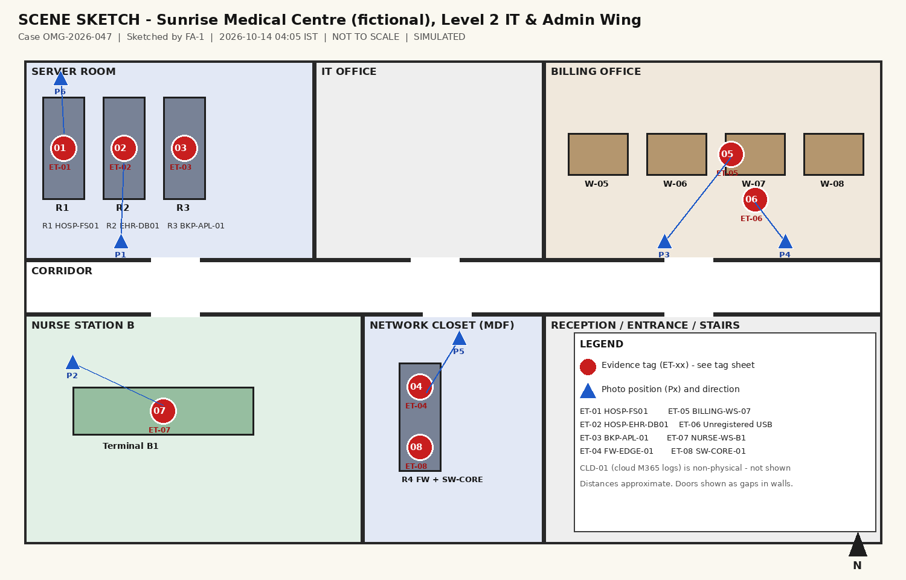
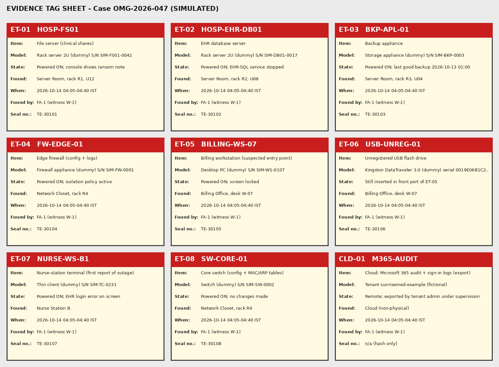

# Case Omega - Part 1: First Responder SOP and Scene Documentation

## 1.1 Case scenario

This narrative is a constructed, fictional scenario. All organisations, people, hosts, IP addresses, hashes, wallets and
logs in this repository are synthetic and exist only for this coursework.

**Case ID:** OMG-2026-047 "Case Omega"
**Victim organisation:** Sunrise Medical Centre (fictional multi-speciality hospital, Gurugram, Haryana)

At 03:05 IST on Wednesday 14 October 2026 the night staff at Nurse Station B reported that the electronic health
record (EHR) system was unavailable. The on-call IT engineer found a ransom note on the clinical file server
(`HOSP-FS01`). Investigation of the logs showed a campaign that began about 41 hours earlier:

1. **12 Oct 09:43** - a billing clerk ran a file downloaded from a fake "insurance claim forms" website; it installed a
   persistent beacon implant on `BILLING-WS-07`.
2. **13 Oct 14:07** - a hospital service account (`svc_backup`) was compromised after repeated failed logons.
3. **13 Oct 18:52** - an unregistered USB drive was inserted into `BILLING-WS-07` after hours and a program ran from it.
4. **13 Oct 19:28 to 23:34** - the attacker used RDP to reach the file server, staged about 7 GiB of data and uploaded
   it to an external web file-drop (data theft).
5. **14 Oct 01:58 to 02:47** - shadow copies were deleted, backups stopped, a ransomware service was installed and the
   file server and the EHR database server were encrypted (`.omega` files, `README_OMEGA.txt` notes).
6. **14 Oct 03:41** - the network was isolated; first responders arrived at 03:52.

## 1.2 Guiding principles for first responders

1. **Patient safety comes first.** Never power off or disconnect a device that supports patient care without clinical
   sign-off. Clinical staff run downtime (paper) procedures while the investigation proceeds.
2. **Preserve evidence, do not alter it.** Work on copies; use write-blocked or read-only access; avoid logging in to
   suspect systems.
3. **Isolate the network, do not power off.** Cutting network access stops further damage and exfiltration, while a
   running system still holds volatile evidence (processes, connections, keys in memory).
4. **Capture the most volatile evidence first** (order of volatility, section 1.6).
5. **Document everything**, with a time, a person and a reason, before and after every action.
6. **Act under proper authority**, with the hospital's written consent and police involvement, and keep a clear chain
   of custody from the first minute.

## 1.3 Standard Operating Procedure (SOP)

### Phase A - Arrival and safety (target: first 15 minutes)

| Step | Action | Rationale | Record |
|---|---|---|---|
| A1 | Report to the incident commander (hospital CISO) and confirm legal authority and scope | No authority, no admissible evidence | Authority note, names, time |
| A2 | Confirm clinical safety with the duty doctor: which systems must stay up, where downtime procedures are in force | Patient safety overrides forensic convenience | Safety checklist |
| A3 | Secure the scene: restrict access to server room, billing office and network closet; start an entry/exit log | Prevent contamination and tampering | Access log |
| A4 | Brief the team: roles (FA-1 lead, FA-2 analyst, W-1 witness/scribe), no one touches keyboards without instruction | Single point of control | Team roster |

### Phase B - Containment checks (15 to 30 minutes)

| Step | Action | Rationale | Record |
|---|---|---|---|
| B1 | Confirm network isolation is in place (here: firewall policy `ISOLATE-OMEGA`, 03:41) and nothing was powered off | Stops spread and exfiltration; keeps memory | Firewall policy export |
| B2 | Do not reboot, log in, run antivirus scans or "clean up" affected machines | Each action overwrites evidence | Instruction log |
| B3 | Ask staff what they saw: first symptom, time, anything plugged in, any unusual email or download | Early witness accounts fade fast | Witness notes |

### Phase C - Scene documentation (30 to 60 minutes)

| Step | Action | Rationale | Record |
|---|---|---|---|
| C0 | Where police seize items, record the search and seizure on video, including preparing the seizure list and witness signatures (BNSS s.105), and use two independent witnesses (BNSS s.103(4)) | Statutory requirement; strengthens credibility | Video file and its hash, seizure list |
| C1 | Photograph each room: overall, mid-range, close-up, before touching anything; include a scale and the screen content | Shows original state | Photo log (section 1.5) |
| C2 | Draw a scene sketch with rooms, racks, desks, cable runs and photo positions | Spatial context for court | `scene_sketch.png` |
| C3 | Record the state of each device: powered on or off, screen content, lights, cables, connected USB devices | Condition at discovery | Evidence tag sheet |
| C4 | Assign a unique evidence tag (ET-xx) and photograph the tag next to the item | Prevents mix-ups | `evidence_tag_sheet.png` |

### Phase D - Volatile data (60 to 90 minutes)

| Step | Action | Rationale | Record |
|---|---|---|---|
| D1 | From a trusted read-only toolkit on external media, capture date/time (and clock offset), logged-on users, running processes, network connections, scheduled tasks and services | Lost at shutdown | `volatile_triage_HOSP-FS01.txt` |
| D2 | Capture memory where tooling and policy allow (not performed in this simulation) | Keys, injected code and credentials may exist only in RAM | Memory image hash |
| D3 | Write all output to external media, never to the suspect disk | Do not alter the source | Media ID |

### Phase E - Acquisition and collection

| Step | Action | Rationale | Record |
|---|---|---|---|
| E1 | Acquire the server data volume through a write-blocked or read-only path (dd or FTK Imager) | Bit-for-bit copy | `acquisition_log.txt` |
| E2 | Hash source before imaging and the image after imaging (SHA-256); stop if they differ | Proves integrity | `.sha256` file |
| E3 | Export firewall, switch, directory-service and cloud (M365) logs; hash each export | Network and cloud evidence | `artefact_hashes.sha256` |
| E4 | Collect the unregistered USB drive and the suspect workstation; photograph in place first | Possible entry vector | Evidence tags ET-05, ET-06 |

### Phase F - Packaging, transport and handover

| Step | Action | Rationale | Record |
|---|---|---|---|
| F1 | Bag and seal each item (anti-static bag or Faraday bag for devices that can receive remote commands), sign across the seal | Tamper evidence | Seal number on tag |
| F2 | Complete the chain-of-custody form at every handover; verify hash at every transfer | Unbroken accountability | CoC form |
| F3 | Brief the hospital: CERT-In report within 6 hours of noticing the incident, police complaint, insurer, regulators | Legal duties and timelines | Notification log |
| F4 | Hand evidence to the forensic lab custodian; keep a copy of all notes | Closes first-response phase | Handover receipt |

## 1.4 Do and do not

| Do | Do not |
|---|---|
| Keep running systems powered on until volatile data is captured | Power off, reboot or "restore from backup" before imaging |
| Use external, trusted tools and read-only media | Install tools on the affected server or log in with domain admin credentials |
| Photograph before touching; note the clock offset | Move items before documenting them |
| Isolate at the network (firewall or switch port) | Delete malware, ransom notes or encrypted files |
| Treat the hospital's clinical workflow as a constraint | Interrupt patient-care equipment |
| Pay no ransom and negotiate with no one without legal advice and law-enforcement involvement | Reply to the attacker from hospital systems |

## 1.5 Scene documentation

### Scene sketch

The sketch shows the IT and administration wing, numbered evidence tags (ET-01 to ET-08) and camera positions (P1 to
P6). It is not to scale.

### Evidence tags

### Photograph log

The images in `evidence/scene/photos/` are clearly labelled simulated placeholders (abstract graphics) that stand in for
real scene photographs.

| Photo | Time (IST) | Subject | Looking at tag |
|---|---|---|---|
| P1 | 04:07 | Server room, racks R1 to R3, wide view from the door | ET-01, ET-02, ET-03 |
| P2 | 04:12 | Nurse Station B, terminal B1 showing the EHR error | ET-07 |
| P3 | 04:18 | Billing office, desk W-07 and workstation | ET-05 |
| P4 | 04:19 | Front panel of the workstation with the USB drive in place | ET-06 |
| P5 | 04:24 | Network closet, rack R4 with firewall and core switch | ET-04, ET-08 |
| P6 | 04:09 | `HOSP-FS01` console showing the ransom note | ET-01 |

### Digital evidence types at this scene

| Evidence type | Item in this case | Tag | Volatility | Collection method |
|---|---|---|---|---|
| Server | `HOSP-FS01` file server | ET-01 | High while powered | Volatile triage, then volume image |
| Server | `HOSP-EHR-DB01` EHR database | ET-02 | High while powered | Image and service logs |
| Backup system | `BKP-APL-01` backup appliance | ET-03 | Medium | Configuration and job logs; check last good backup |
| Network device | `FW-EDGE-01` firewall | ET-04 | Medium | Config and traffic-log export |
| Network device | `SW-CORE-01` core switch | ET-08 | High (MAC/ARP tables) | Table and config export |
| Personal computer | `BILLING-WS-07` | ET-05 | High while powered | Image; event logs; browser history |
| Removable media | Unregistered USB flash drive | ET-06 | Low | Photograph in place, bag, image through a write blocker |
| Thin client | `NURSE-WS-B1` | ET-07 | Medium | Photograph screen; record error text |
| Cloud access point | Microsoft 365 audit and sign-in logs | CLD-01 | Medium (retention limits) | Admin export, hash, record who exported |
| Not yet collected | Mobile phones of the billing staff, CCTV and badge logs, email gateway logs | - | Varies | Follow-up requests listed in Part 4 |

## 1.6 Order of volatility used in this response

1. CPU registers and cache (not practical to collect)
2. Memory (RAM), running processes, network connections, logged-on sessions
3. Network state: ARP and MAC tables, routing table, firewall state
4. Temporary files and swap
5. Disk contents (volume images)
6. Remote logging and monitoring data (firewall, cloud, directory service)
7. Physical configuration and archival media (backups, USB)

---

*Next: Part 2 - Evidence collection and chain of custody.*
