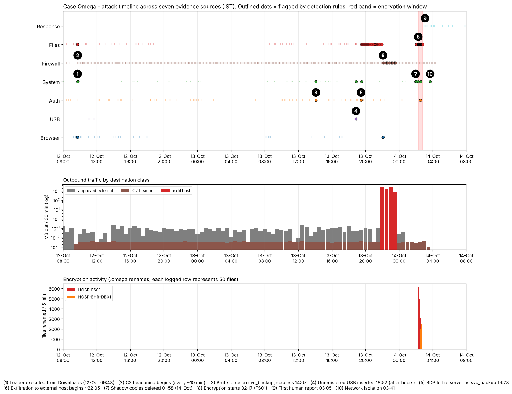
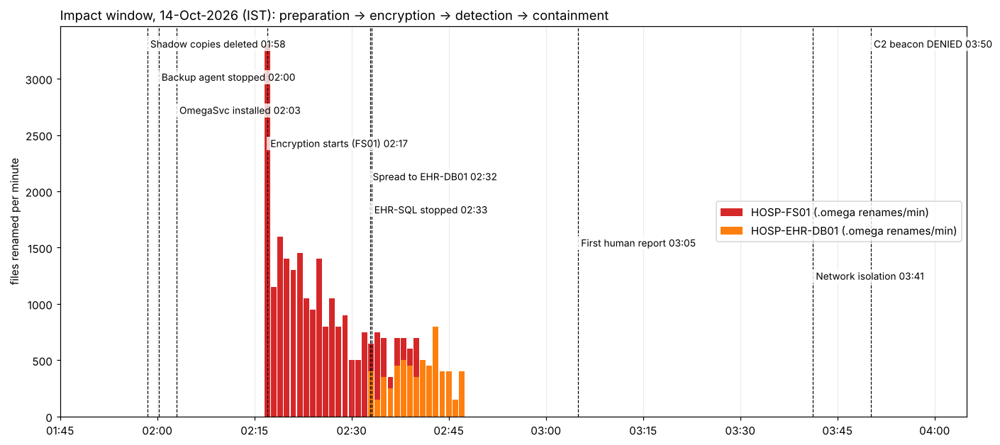

# Case Omega - Part 4: Data Acquisition and Timeline Creation

## 4.1 Data sources

Seven sources were exported, hashed (see Part 2) and normalised to one time base, India Standard Time (UTC+05:30).
Where a real case would use Plaso (`log2timeline`) on Windows artefacts, this simulation uses Python scripts (the task
allows either) on synthetic CSV logs.

| Source | File | Rows | Typical fields | What it answers |
|---|---|---|---|---|
| Authentication | `auth_events.csv` | 65 | event ID 4624/4625/4672, account, source IP, logon type | Who logged on where, from where, and what failed first |
| System and process | `system_events.csv` | 39 | process creation 4688, tasks 4698, services 7036/7045, firewall policy change | What ran, what persisted, what was stopped |
| USB | `usb_events.csv` | 3 | vendor/product ID, serial, in asset inventory? | Which removable devices appeared |
| Browser history | `browser_history.csv` | 28 | URL, event (visit, download, upload), resolved IP | How the loader arrived and where data was sent |
| Firewall | `firewall_log.csv` | 485 | source, destination, bytes out, rule, action | C2 beaconing, exfiltration volume, containment |
| File activity | `file_changes.csv` | 682 | path, action, size, files represented | Staging, malware drops, encryption burst |
| Response notes | `response_events.csv` | 12 | actor, event, category | Human detection and response times |
| **Total** | | **1,314 events** | | |

The file-activity log is a **sample**: each rename row in the encryption burst represents 50 files
(`files_represented`), so counts of files are estimates.

## 4.2 Method

```text
load 7 sources -> convert to IST -> add one normalised event per row
   -> apply named detection rules -> flag and assign an attack phase
   -> correlate across sources (time windows, shared hosts, accounts, IPs)
   -> compute metrics -> write CSV, Markdown, text and charts
```

Run it with:

```bash
python3 tools/timeline_builder.py evidence/logs evidence/timeline
```

### Detection rules

| Rule | Logic | Phase |
|---|---|---|
| `SUSPICIOUS_DOWNLOAD` | Browser download from a domain outside the approved list | Initial Access |
| `EXEC_FROM_DOWNLOADS` | Process started from a Downloads path with a `.pdf.exe` double extension | Initial Access |
| `PERSISTENCE_SCHEDULED_TASK` | Event 4698 creating a task that runs a user-profile executable | Persistence and C2 |
| `PERIODIC_BEACON` | At least 20 outbound sessions to one external IP with very regular gaps (coefficient of variation below 0.1) | Persistence and C2 |
| `CREDENTIAL_STORE_ACCESS` | Sysmon event showing read access to `lsass.exe` memory | Credential Access |
| `BRUTE_FORCE_THEN_SUCCESS` | Five or more failures for one account from one source, then a success within 10 minutes | Credential Access |
| `UNREGISTERED_USB_OFF_HOURS` | USB insertion for a device not in the asset inventory, outside 08:00 to 18:00 | Lateral Movement |
| `EXEC_FROM_REMOVABLE` | Process started from a non-system drive letter | Lateral Movement |
| `RDP_BY_SERVICE_ACCOUNT` | Logon type 10 (RDP) by an `svc_` account | Lateral Movement |
| `DATA_STAGING` and `EXFIL_SESSION` | Many large archives in a staging folder; outbound sessions of 100 MB or more to non-approved IPs | Collection and Exfiltration |
| `RECOVERY_INHIBITION` and `SERVICE_STOPPED` | Shadow-copy deletion; backup or database service stopped | Defense Evasion |
| `MASS_RENAME_OMEGA` and `RANSOM_NOTE_CREATED` | Bulk renames to `.omega`; `README_OMEGA.txt` created | Impact |
| `CONTAINMENT` | Firewall isolation policy applied | Response |

The builder flagged 22 findings among the 1,314 events.

## 4.3 Reconstructed timeline

All times IST. The complete generated table is in `evidence/timeline/timeline_key_events.md` and every normalised event is
in `evidence/timeline/timeline_full.csv`.

| Time | Host | Event | Source | Phase |
|---|---|---|---|---|
| 12-Oct 09:41:12 | BILLING-WS-07 | Clerk opens fake "claim forms" site | Browser | Initial Access |
| 12-Oct 09:42:03 | BILLING-WS-07 | `InsuranceClaim_Form_Oct.pdf.zip` downloaded | Browser | Initial Access |
| 12-Oct 09:43:25 | BILLING-WS-07 | Loader executed from Downloads | System (4688) | Initial Access |
| 12-Oct 09:43:41 | BILLING-WS-07 | Task `OfficeUpdateSync` created (every 10 min) | System (4698) | Persistence |
| 12-Oct 09:44:02 | BILLING-WS-07 | First beacon to `198.51.100.23:443` | Firewall | C2 |
| 13-Oct 14:04:40 | BILLING-WS-07 | Implant reads `lsass.exe` memory | System (Sysmon 10) | Credential Access |
| 13-Oct 14:05:10 to 14:05:55 | HOSP-DC01 | Six failed logons for `svc_backup` from `10.20.8.17` | Auth (4625) | Credential Access |
| 13-Oct 14:07:22 | HOSP-DC01 | `svc_backup` logs on successfully | Auth (4624) | Credential Access |
| 13-Oct 18:52:07 | BILLING-WS-07 | Unregistered USB inserted, after hours | USB | Lateral Movement |
| 13-Oct 18:53:30 | BILLING-WS-07 | `E:\sysdiag.exe` runs, launched by the implant | System (4688) | Lateral Movement |
| 13-Oct 19:28:44 | HOSP-FS01 | RDP logon by `svc_backup` from the billing PC | Auth (4624 type 10) | Lateral Movement |
| 13-Oct 19:30:51 | HOSP-FS01 | Archiver `arch.exe` starts staging | System (4688) | Collection |
| 13-Oct 19:31 to 21:56 | HOSP-FS01 | 20 archives (6.99 GiB) created in Temp | Files | Collection |
| 13-Oct 22:04:11 | HOSP-FS01 | Browser opens `file-drop-secure[.]io` | Browser | Exfiltration |
| 13-Oct 22:04:55 to 23:34 | HOSP-FS01 | Nine uploads to `203.0.113.88` (6.93 GiB) | Firewall | Exfiltration |
| 14-Oct 01:58:30 | HOSP-FS01 | Shadow copies deleted | System (4688) | Recovery denial |
| 14-Oct 02:00:15 | HOSP-FS01 | Backup agent stopped | System (7036) | Recovery denial |
| 14-Oct 02:03:00 | HOSP-FS01 | Service `OmegaSvc` installed | System (7045) | Impact |
| 14-Oct 02:17:03 | HOSP-FS01 | Encryption starts | Files, System | Impact |
| 14-Oct 02:17:41 | HOSP-FS01 | Ransom notes written | Files | Impact |
| 14-Oct 02:32:50 | HOSP-EHR-DB01 | `svc_backup` network logon from the file server | Auth (4624) | Lateral Movement |
| 14-Oct 02:33:05 | HOSP-EHR-DB01 | `EHR-SQL` stopped | System (7036) | Impact |
| 14-Oct 02:33:10 to 02:47:47 | HOSP-EHR-DB01 | EHR data files renamed to `.omega` | Files | Impact |
| 14-Oct 02:41:37 | HOSP-FS01 | Last file-server rename | Files | Impact |
| 14-Oct 03:05:00 | Nurse Station B | Staff report EHR unavailable | Response notes | Detection |
| 14-Oct 03:41:15 | FW-EDGE-01 | Isolation policy applied | System | Containment |
| 14-Oct 03:50:11 onward | BILLING-WS-07 | Four beacons to C2 denied | Firewall | Containment |
| 14-Oct 03:52:00 | Site | First responder arrives | Response notes | Response |

## 4.4 Correlation findings

These come from `evidence/timeline/correlation_findings.txt`, produced by the script.

| ID | Finding | Value |
|---|---|---|
| C1 | Dwell time from first malicious execution to encryption | 40 h 33 m 38 s |
| C2 | C2 beaconing: 252 sessions, median gap 10.0 min, regularity (CV) 0.024; first beacon 37 s after the loader ran | 12-Oct 09:44 to 14-Oct 03:34 |
| C3 | Credential-store access at 14:04:40 followed 2 m 42 s later by a successful `svc_backup` logon after six failures | Sequence confirmed |
| C4 | USB insertion to program run from `E:\` | 1 m 23 s |
| C4 | USB insertion to RDP logon on the file server | 36 m 37 s |
| C5 | Staging volume and upload volume | 6.99 GiB staged, 6.93 GiB uploaded |
| C5 | Browser history, firewall and file system agree on the same destination and time window | Three-source corroboration |
| C6 | Preparation before encryption (shadow copies deleted at 01:58:30, encryption at 02:17:03) | 18 m 33 s |
| C7 | File server encryption | 24 m 34 s, about 24,500 files, peak about 3,300 per minute |
| C7 | EHR database server encryption | 14 m 37 s, about 6,000 files, peak about 800 per minute |
| C8 | Encryption start to first human report | 47 m 57 s |
| C8 | Encryption start to network isolation | 1 h 24 m 12 s |
| C8 | Last upload session to isolation | 4 h 07 m 00 s |
| C8 | First malicious execution to isolation | 41 h 57 m 50 s |

Two points follow from the correlations. First, **detection came from clinical staff noticing an outage, not from any
security control**: nothing in the evidence shows an alert for 252 beacons, a 7 GiB upload or a service-account RDP
logon. Second, the USB device appears **after** the implant was already beaconing, so it is not the initial entry
vector; it is a later step whose handler is still unidentified.

## 4.5 Visualisations

### Overview of all sources, traffic and encryption



### Zoom on the impact window



## 4.6 Open leads and unanswered questions

| Question | Why it matters | Next step |
|---|---|---|
| Who inserted the USB drive at 18:52, and how was it obtained? | Possible insider or physical access; the billing clerk's session was the only one logged in | CCTV and badge records, interview staff, image the USB (ET-06) |
| How was the clerk led to the fake claim-form site? | Identifies the lure and other recipients | Email gateway logs, search the mailbox, check other users' browser history |
| What data left the network? | Drives patient-notification duties | Inventory the 20 staging archives against share contents; review the file-drop provider response |
| Is any other host running `osync.exe`? | Scope of compromise | Sweep with the IOC list across endpoints and DNS logs |
| How was `svc_backup` guessed? | Weak or reused password; exposed service account | Review the account's password history and where it was used |
| Was RAM captured? | Keys and injected code | Not captured in this simulation; flagged as a gap in Part 2 |

## 4.7 Limitations

- All logs are synthetic. The generator (`tools/generate_simulated_logs.py`) produces them from a fixed random seed, so
  they are reproducible, but patterns such as the exact 10-minute beacon interval are cleaner than real traffic.
- File-activity rows are sampled; the counts of files are estimates.
- Clocks are assumed synchronised. In a real case the offset of every device from a trusted time source must be
  recorded, because CERT-In directions require synchronisation with the national time servers (NIC or NPL).

---

*Next: Part 5 - the investigation report for law enforcement (`report/`).*
