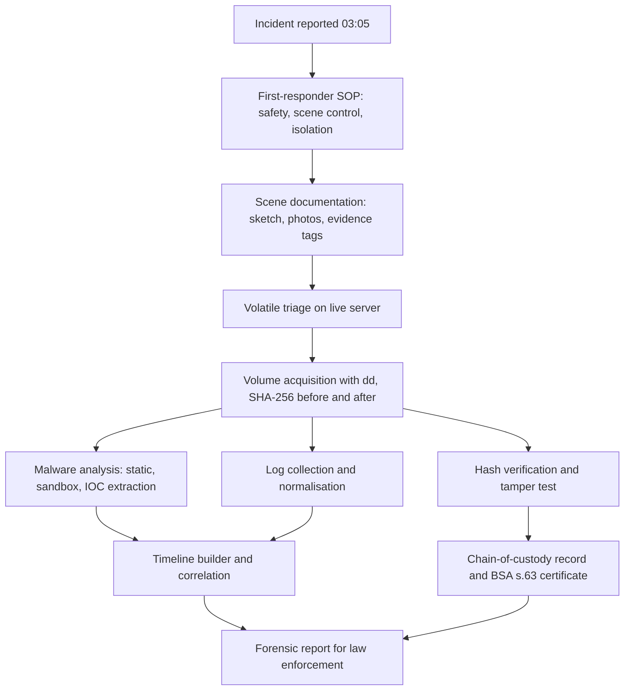

# Case Omega - Tool Summary and Workflow

## Workflow



## Tools: what was run and what was only referenced

"Run" means it was executed in this repository's environment and its output is saved. "Referenced" means it is the tool a
real investigation would use, named for context but not run here.

| Tool | Status | Command or use | Why this tool |
|---|---|---|---|
| `tools/acquire_image.sh` (wrapper around `dd` and `sha256sum`) | Run | `tools/acquire_image.sh <src> <image> <hashfile>` | Reproducible bit-for-bit acquisition with the pre- and post-hash comparison built in |
| `dd` | Run | `dd if=<src> of= bs=4M conv=noerror,sync` | Standard, available everywhere; `noerror,sync` keeps offsets aligned on bad sectors |
| `sha256sum` | Run | `sha256sum <file>` | Integrity hash; SHA-256 is what the BSA certificate and court practice expect |
| `tools/verify_image_hash.py` | Run | `python3 tools/verify_image_hash.py evidence/acquisition` | Re-verification at every handover; also used by CI |
| `debugfs` (e2fsprogs) | Run | `debugfs -R "ls -l /Shares" <image>` | Read-only listing of the simulated volume without mounting it |
| `tools/generate_simulated_logs.py` | Run | `python3 tools/generate_simulated_logs.py evidence/logs` | Reproducible synthetic log data (fixed seed) |
| `tools/generate_scene_docs.py` | Run | `python3 tools/generate_scene_docs.py evidence/scene` | Builds the scene sketch, tag sheet and labelled placeholder photos |
| `tools/ioc_extractor.py` | Run | `python3 tools/ioc_extractor.py <reports> --compare ioc_list.csv` | Pulls IOCs out of analyst text and cross-checks the curated list |
| `tools/timeline_builder.py` | Run | `python3 tools/timeline_builder.py evidence/logs evidence/timeline` | Normalises seven sources, applies detection rules, correlates, charts |
| matplotlib | Run | used by the timeline builder | Swim-lane and rate charts |
| `markdownlint` (markdownlint-cli) | Run | `markdownlint '**/*.md' --disable MD013 MD033 MD060` | Same check as the CI workflow |
| FTK Imager | Referenced | Create Disk Image, E01 or raw, with verify | Industry-standard imager for Windows; replaced here by `dd` |
| Plaso / `log2timeline` | Referenced | `log2timeline.py --storage-file x.plaso <image>` then `psort.py` | Parses Windows artefacts into a super-timeline; replaced here by the Python builder on CSV logs |
| Hardware write blocker | Referenced | Between source drive and acquisition laptop | Guarantees read-only access to a pulled drive |
| Volatility, WinPmem | Referenced | RAM capture and analysis | Not performed; listed as a gap |
| YARA, PE-bear, capa | Referenced | Static analysis of the sample | Documented in the static report as findings; no malware binary is included |
| Sandbox (isolated VM, simulated network) | Referenced | Dynamic analysis | Findings recorded in the dynamic report as a simulated observation |

## Why a custom script instead of a ready-made timeline tool

`log2timeline` is the right tool for real Windows images, but it needs real artefacts (event logs, registry, MFT). This
exercise uses synthetic CSV logs, and the task also allows Python scripts. A purpose-built script lets the detection
rules and correlation logic be shown explicitly (for example, the beacon-regularity test and the USB-to-execution window),
which is the point of the exercise.

## Reproducing everything

```bash
python3 tools/generate_simulated_logs.py evidence/logs
python3 tools/generate_scene_docs.py evidence/scene
python3 tools/verify_image_hash.py evidence/acquisition
python3 tools/ioc_extractor.py evidence/malware-analysis/static_analysis_report.txt \
    evidence/malware-analysis/dynamic_analysis_report.txt --compare evidence/malware-analysis/ioc_list.csv
python3 tools/timeline_builder.py evidence/logs evidence/timeline
```

Requirements: Python 3.8 or later, Pillow and matplotlib (`pip install pillow matplotlib`). The acquisition script
needs a Linux or WSL shell with `dd` and `sha256sum`.
